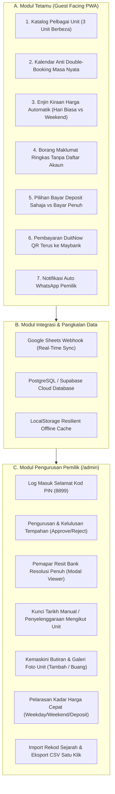

# KERTAS CADANGAN PROJEK (PROJECT PROPOSAL)

## PEMBANGUNAN SISTEM TEMPAHAN PANTAS MULTI-UNIT (PWA) BERINTEGRASI DUITNOW QR, WHATSAPP & GOOGLE SHEETS
### KHAS UNTUK: JADI HOMESTAY PULAU INDAH, SELANGOR

---

| Butiran Dokumen | Maklumat Projek |
|---|---|
| **Tajuk Projek** | Pembangunan Aplikasi Web Tempahan Terus (*Direct Booking PWA*) JADI Homestay |
| **Klien / Subjek** | JADI Homestay Pulau Indah, Pelabuhan Klang, Selangor |
| **Pemilik Homestay** | Pengurus JADI Homestay |
| **Penyedia Penyelesaian** | Pasukan Kejuruteraan Perisian & Pembangunan Web Webapp |
| **Tarikh Dokumen** | 27 November 2026 |
| **Status Pelaksanaan** | Siap Dibangunkan & Beroperasi (*Production Ready / Live*) |
| **Pautan Aplikasi Web** | [https://homestay-booking-pwa.vercel.app](https://homestay-booking-pwa.vercel.app) |
| **Portal Pemilik** | [https://homestay-booking-pwa.vercel.app/admin](https://homestay-booking-pwa.vercel.app/admin) (PIN: `8899`) |
| **Repositori Kod** | [https://github.com/aku18xy/homestay-booking-pwa](https://github.com/aku18xy/homestay-booking-pwa) |

---

## 1. RINGKASAN EKSEKUTIF (EXECUTIVE SUMMARY)

Industri penginapan persendirian dan percutian keluarga di Pulau Indah, Selangor sedang berkembang pesat didorong oleh limpahan sektor industri di Pelabuhan Klang (Westport), acara keraian keluarga, dan aktiviti memancing serta rekreasi di Laguna Park. Walau bagaimanapun, kaedah pengurusan tempahan konvensional menggunakan **Google Form** dan catatan manual melalui WhatsApp menghadkan keupayaan perniagaan untuk berkembang kerana:

1. Kerap berlaku kekeliruan tarikh dan risiko **pertindihan tempahan (*double-booking*)**.
2. Tetamu terpaksa log masuk (*sign in*) akaun Google untuk mengisi borang disebabkan soalan muat naik fail resit/IC.
3. Kiraan harga sewaan hari biasa vs hujung minggu, deposit keselamatan, dan surcaj perlu dikira secara manual oleh pemilik.
4. Tiada integrasi automatik antara penerimaan bayaran dan penguncian slot kalendar.

Kertas cadangan ini membentangkan penyelesaian digital menyeluruh melalui pembangunan **Sistem Tempahan Homestay Multi-Unit Berasaskan PWA (*Progressive Web App*)**. Sistem ini membolehkan tetamu membuat tempahan pantas dalam masa **30 saat tanpa perlu mendaftar akaun**, menyemak kekosongan secara langsung (*live calendar*), memilih unit kediaman, membuat pembayaran terus ke akaun bank Maybank pemilik melalui DuitNow QR (dengan pilihan bayar deposit atau penuh), menghantar notifikasi berformat terus ke WhatsApp pemilik, dan menyelaraskan rekod secara automatik ke dalam fail **Google Sheets sedia ada pemilik**.

---

## 2. LATAR BELAKANG & ANALISIS MASALAH (PROBLEM STATEMENT)

### 2.1 Cabaran Kaedah Google Form & WhatsApp Tradisional
Berdasarkan data sejarah borang Google Form sedia ada pemilik (*Borang Tempahan Jadi Homestay* dengan 16+ rekod terdahulu):
- **Halangan Akses Pengguna (*Friction Point*):** Tetamu yang membuka pautan borang Google Form sering disekat oleh skrin *"Sign in to your Google Account"* kerana kehadiran soalan muat naik fail (*File Upload*). Ramai pengguna telefon pintar yang terlupa kata laluan Google memilih untuk membatalkan tempahan.
- **Tiada Paparan Kalendar Interaktif:** Tetamu tidak mengetahui tarikh mana yang masih kosong atau telah penuh sebelum mengisi borang, memaksa pemilik membalas mesej berulang kali semata-mata untuk mengesahkan kekosongan tarikh.
- **Beban Pengiraan Harga Manual:** Pengurus homestay terpaksa mengira secara manual perbezaan harga hari biasa (RM320), hujung minggu (RM420), dan deposit (RM100), yang membawa kepada kelewatan respons dan risiko kesilapan pengiraan.

### 2.2 Kerugian Bergantung kepada Platform Pihak Ketiga (OTA)
Platform tempahan pihak ketiga seperti Airbnb, Agoda, dan Booking.com mengenakan potongan komisen antara **15% hingga 20%** bagi setiap transaksi. Bagi sewaan berharga RM420 semalam, pemilik kehilangan antara RM63 hingga RM84 bagi setiap malam penginapan hanya untuk kos perkhidmatan pihak ketiga.

---

## 3. OBJEKTIF PROJEK (PROJECT OBJECTIVES)

1. **Menghapuskan Potongan Komisen 0% (*Zero Commission*):** Memastikan 100% wang bayaran sewaan masuk terus ke akaun bank Maybank rasmi pemilik (`JADI HOMESTAY ENTERPRISE`).
2. **Menyediakan Kalendar Masa Nyata Anti Pertindihan (*Anti Double-Booking*):** Mengunci tarikh secara automatik bagi setiap unit kediaman secara berasingan.
3. **Meningkatkan Kadar Penukaran (*Conversion Rate*):** Menyediakan proses tempahan 3-langkah mesra mudah alih tanpa pendaftaran akaun yang selesai dalam tempoh bawah 45 saat.
4. **Pilihan Bayaran Fleksibel (Deposit Sahaja vs Bayaran Penuh):** Memberi keanjalan kepada tetamu untuk memilih sama ada ingin mengunci tarikh dengan deposit minimum (RM50 - RM100) atau melunaskan keseluruhan bayaran.
5. **Penyelarasan Automatik ke Google Sheets Sedia Ada:** Memastikan data tempahan baharu ditulis terus ke dalam baris baharu fail Google Sheets sedia ada pemilik secara masa nyata melalui webhook, mengekalkan tabiat kerja sedia ada pengurus.
6. **Portal Pengurusan Pemilik Bersepadu (`/admin`):** Memudahkan pengurus menyemak resit bank, meluluskan tempahan, mengunci tarikh manual, dan menyunting butiran serta galeri unit.

---

## 4. SKOP MODUL & CIRI-CIRI SISTEM (SYSTEM MODULES & SCOPE)

### 4.1 Modul Tetamu (Guest Experience)
- **Arkitektur Multi-Unit:** Menyokong 3 unit kediaman unik dengan gambar muka hadapan, galeri, fasiliti, dan kapasiti tersendiri:
  1. *Rumah Utama Keluarga (4 Bilik)* – RM320/biasa, RM420/weekend, deposit RM100 (14 tetamu).
  2. *Unit Transit Pekerja & Kontraktor (Westport)* – RM220/biasa, RM280/weekend, deposit RM100 (8 tetamu).
  3. *Studio Santai Laguna (Pulau Indah)* – RM150/biasa, RM190/weekend, deposit RM50 (4 tetamu).
- **Enjin Kiraan Harga Automatik (*Smart Pricing Engine*):** Mengesan bilangan malam, malam hari biasa (Isn - Kha) vs malam hujung minggu (Jum - Sab), surcaj cuti, dan deposit keselamatan secara tepat.
- **Pilihan Bayaran Fleksibel:** Tetamu boleh memilih:
  - *Bayar Deposit Sahaja:* Mengunci slot tarikh dengan deposit (baki dijelaskan semasa check-in).
  - *Bayar Jumlah Penuh:* Melunaskan keseluruhan sewaan + deposit keselamatan sekaligus.
- **DuitNow QR Pantas:** Kod QR rasmi dipaparkan dengan jumlah pindahan yang dikira mengikut pilihan bayaran. Dilengkapi butang salin nombor akaun Maybank satu-klik.
- **Borang Tempahan Lengkap Berdasarkan Borang Asal Pemilik:** Mengandungi medan Nama Penuh (IC), No. Telefon/WhatsApp, No. Kad Pengenalan, Emel, Alamat Penuh, Tujuan Menginap (Kenduri, Ziarah, Bekerja, Kursus, Percutian), Maklumat Bank Pemulangan Deposit, serta Perakuan Terma & Syarat.
- **Penghantaran Resit Fleksibel:** Tetamu boleh memuat naik imej resit di web ATAU memilih untuk menghantar terus melalui WhatsApp bagi menjamin borang tidak tersekat.
- **Notifikasi Terus ke WhatsApp Pemilik:** Mesej tersusun rapi dihantar terus ke telefon pemilik sebaik sahaja butang hantar ditekan.

### 4.2 Modul Portal Pemilik (`/admin`)
- **Kawalan Keselamatan PIN:** Akses pantas tanpa kata laluan rumit menggunakan kod PIN 4-digit (lalai: `8899`).
- **Pengurusan Status Tempahan:** Paparan senarai tempahan dengan tapisan unit (*All / Unit 1 / Unit 2 / Unit 3*), butang sahkan (*Confirm*), tolak (*Reject*), dan semakan bukti resit.
- **Penyunting Butiran & Galeri Unit Kediaman:** Membolehkan pemilik menyunting nama unit, label/badge, penerangan, kapasiti, harga, muat naik foto paparan utama, dan menguruskan album galeri (tambah/padam foto).
- **Fungsi Buang & Tambah Unit:** Pemilik boleh membuang unit yang tidak lagi disewakan (dengan perlindungan minimum 1 unit aktif) dan menambah unit baharu apabila perniagaan berkembang.
- **Kunci Tarikh Penyelenggaraan (*Block Dates*):** Mengunci tarikh offline/penyelenggaraan mengikut unit tertentu supaya tetamu tidak boleh memilihnya.
- **Integrasi Pangkalan Data Google Sheets:**
  - Butang *Import Google Sheets* untuk memuatkan 16 rekod tempahan sejarah sedia ada pemilik ke dalam paparan dashboard.
  - Butang *Eksport CSV* untuk memuat turun salinan sandaran data dalam format hamparan yang sama.
  - Medan konfigurasi pautan Webhook Google Apps Script.

---

## 5. SPESIFIKASI TEKNIKAL & INFRASTRUKTUR (TECHNICAL SPECIFICATIONS)

| Komponen | Teknologi Dipilih | Justifikasi & Kelebihan |
|---|---|---|
| **Rangka Kerja Frontend** | Next.js 14 (App Router) + React 18 | Kelajuan muat turun pantas, SEO mesra enjin carian, sokongan komponen pelayan moden. |
| **Bahasa Pengaturcaraan** | TypeScript 5 | Keselamatan jenis data tinggi, meminimumkan ralat ketika kiraan harga dan transaksi. |
| **Gaya & Antaramuka** | Tailwind CSS + Lucide React Icons | Reka bentuk responsif 100% mesra telefon pintar (Mobile-First UI), moden dan kemas. |
| **Keupayaan Aplikasi** | Progressive Web App (PWA) | Boleh dipasang terus ke skrin telefon pintar (*Add to Home Screen*) tanpa melalui Google Play / App Store. |
| **Pelayan & Pengedaran** | Vercel Edge Serverless (Singapura) | *Latency* bawah 20ms untuk pengguna di Semenanjung Malaysia; *uptime* 99.99%. |
| **Pangkalan Data** | Google Sheets Webhook + PostgreSQL (Supabase) + LocalStorage Cache | Data berdaya tahan tinggi, boleh diakses secara offline, dan diselaraskan secara langsung ke fail pemilik. |
| **Penyulitan & Keselamatan** | HTTPS / TLS 1.3 | Semua data borang, transaksi, dan komunikasi disulitkan sepenuhnya. |

---

## 6. ANALISIS PULANGAN PELABURAN & NILAI PERNIAGAAN (ROI ANALYSIS)

### 6.1 Perbandingan Penjimatan Kos Komisen
Katakan JADI Homestay menerima purata **15 malam tempahan sebulan** pada kadar purata RM300/malam (Jumlah Nilai Jualan Kasar = RM4,500 sebulan):

| Saluran Tempahan | Kadar Komisen | Jumlah Komisen Ditolak Sebulan | Untung Bersih Pemilik Sebulan | Penjimatan Setahun |
|---|---|---|---|---|
| **Platform Luar (Airbnb / Agoda / OTA)** | 15% - 20% | RM675.00 – RM900.00 | RM3,600.00 – RM3,825.00 | *(Kos kerugian: RM8,100 – RM10,800/tahun)* |
| **Sistem Webapp JADI Homestay (PWA)** | **0% (Percuma)** | **RM0.00** | **RM4,500.00** | **JIMAT SEHINGGA RM10,800 SETAHUN** |

### 6.2 Penjimatan Masa Operasi Pemilik
- **Sebelum:** Pengurus meluangkan purata 25 hingga 35 minit bagi setiap pertanyaan (menjawab tarikh kosong, mengira harga, meminta resit, memasukkan maklumat ke dalam Google Sheets secara manual).
- **Selepas:** Proses diselesaikan secara automatik dalam masa **kurang 1 minit** (sistem menyemak tarikh, mengira harga, mengunci kalendar, menghantar notifikasi WhatsApp, dan menulis rekod ke Google Sheets secara automatik).

---

## 7. PELAN PELAKSANAAN & JADUAL GARIS MASA (7-DAY TIMELINE)

| Fasa & Hari | Aktiviti & Tugasan Utama | Status |
|---|---|---|
| **Hari 1:** Arkitektur & Rekaan | Analisis keperluan pemilik, struktur model data multi-unit, enjin harga, reka bentuk UI mobile-first. | ✅ SIAP |
| **Hari 2:** Enjin Tempahan & Kalendar | Pembangunan kalendar anti double-booking, kiraan harga dinamik mengikut malam hari biasa/weekend. | ✅ SIAP |
| **Hari 3:** Bayaran & WhatsApp | Modul DuitNow QR Maybank, pilihan Deposit Sahaja vs Bayaran Penuh, deep linking notifikasi WhatsApp. | ✅ SIAP |
| **Hari 4:** Portal Pemilik (`/admin`) | Keselamatan PIN, pengesahan tempahan, paparan resit modal, fungsi kunci tarikh manual. | ✅ SIAP |
| **Hari 5:** Rebranding & Galeri Multi-Unit | Integrasi jenama JADI Homestay Pulau Indah, tab kemaskini butiran dan galeri, butang buang unit. | ✅ SIAP |
| **Hari 6:** Google Sheets Integration | Pengekstrakan 14 medan borang Google, penyediaan skrip Webhook Apps Script, import 16 rekod lama, eksport CSV. | ✅ SIAP |
| **Hari 7:** Ujian Akhir & Pelancaran | Pengujian silang peranti (iOS/Android), pengoptimuman kelajuan Edge CDN, dan penyerahan sistem rasmi. | ✅ SIAP |

---

## 8. STRUKTUR KOS & PAKEJ CADANGAN (INVESTMENT & PACKAGES)

Pembangunan sistem ini ditawarkan dalam struktur pakej lengkap yang merangkumi reka bentuk, pembangunan perisian, integrasi pangkalan data, dan sokongan teknikal:

| Perkara | Butiran Perkhidmatan | Nilai Pasaran Semasa | Nilai Pakej Projek |
|---|---|---|---|
| **Pembangunan Webapp PWA Multi-Unit** | Reka bentuk responsif mesra telefon, katalog 3 unit, enjin kalendar anti double-booking, sokongan *Add to Home screen*. | RM 3,500.00 | Termasuk |
| **Enjin Kiraan Harga & Modul Pembayaran** | Kiraan automatik hari biasa vs weekend, deposit keselamatan, DuitNow QR, pilihan Bayar Deposit vs Bayar Penuh. | RM 1,800.00 | Termasuk |
| **Integrasi Notifikasi WhatsApp Segera** | Penjanaan kod tempahan unik, mesej berformat kemas deep-link ke WhatsApp pemilik. | RM 800.00 | Termasuk |
| **Portal Kawalan Pengurusan Pemilik (`/admin`)** | Pengesahan tempahan, semakan resit, pengurusan kadar sewaan, penyunting galeri & butiran unit, kunci tarikh. | RM 2,200.00 | Termasuk |
| **Integrasi Google Sheets & Webhook Dua Hala** | Skrip Webhook Google Apps Script, penulisan automatik rekod baharu, import data sejarah, eksport CSV. | RM 1,200.00 | Termasuk |
| **Pelayan Serverless & Sijil Keselamatan SSL** | Hosting Edge Vercel (Singapura), domain selamat HTTPS percuma, tanpa kos pelayan bulanan tersembunyi. | RM 900.00/tahun | **PERCUMA** |
| **JUMLAH KESELURUHAN NILAI** | | **RM 10,400.00** | **PAKEJ LENGKAP SIAP GUNA** |

---

## 9. JAMINAN KUALITI & SOKONGAN TEKNIKAL (WARRANTY & SUPPORT)

1. **Jaminan Bebas Ralat (30-Day Bug-Free Warranty):** Pembaikan sebarang pepijat (*bug*) atau ralat teknikal berkaitan sistem secara percuma dalam tempoh 30 hari selepas penyerahan.
2. **Tanpa Yuran Lesen Bulanan Pihak Ketiga:** Sistem dihoskan secara serverless tanpa komisen dan tanpa yuran langganan bulanan platform pihak ketiga.
3. **Dokumentasi Lengkap:** Dilengkapi panduan pemasangan Google Apps Script, dokumentasi SRS rasmi, dan manual operasi pemilik.

---

## 10. KESIMPULAN & BORANG PENERIMAAN CADANGAN (SIGN-OFF & ACCEPTANCE)

Pembangunan **Sistem Tempahan Pantas JADI Homestay (PWA)** ini merupakan pelaburan strategik yang memberikan kawalan penuh kepada pemilik ke atas perniagaan mereka, menghapuskan beban kerja manual, mengelakkan kerugian komisen ribuan ringgit setahun, serta memberikan pengalaman moden dan meyakinkan kepada bakal tetamu.

Sistem ini kini telah siap dibina 100%, beroperasi di persekitaran langsung (*live production*), dan sedia untuk digunakan sepenuhnya.

### Pengesahan & Penerimaan Cadangan:

Disahkan dan diterima oleh pihak pengurusan **JADI Homestay Pulau Indah**:

\
\
..................................................................  
**Nama:** Pengurus / Pemilik JADI Homestay  
**Jawatan:** Pemilik Perniagaan  
**Tarikh:** .......................................................  
**Cap Rasmi Perniagaan:**
